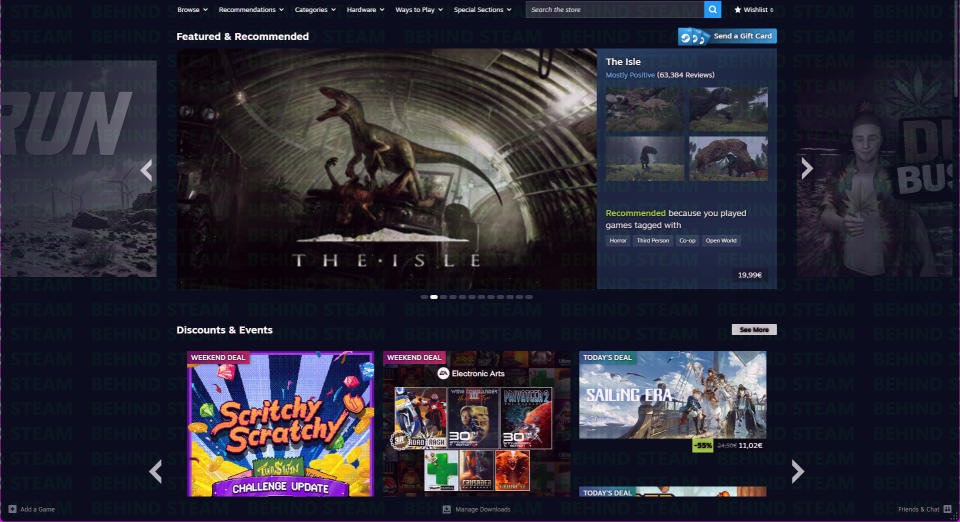

# Glass Desktop

A truly see-through Steam theme for [Millennium](https://steambrew.app).
Your real desktop and the windows behind Steam show through the Library, Store,
Community, Help, Settings and menus. Text, cards and game art stay sharp and readable.
Profile pages keep their own background.



## What it does

- **Real transparency, not a wallpaper.** Moving a window behind Steam shows it live.
- **Readable on any desktop.** Text sits on smoked-glass cards and has a tuned dark
  outline. Glass tint strength keeps text readable on white wallpapers.
- **One look everywhere.** Library, Downloads, Store and its pages, Community (Discussions,
  Workshop, Market, hubs), Help, Settings, friends, context menus and modals.
  Steam's background art is removed. Your profile is left alone.
- **Screenshot-safe.** Ctrl+Alt+T (configurable) turns transparency off and on.
  When it is off, Steam shows a solid dark background.
- **Survives Steam updates.** No Steam hashed class names are hard-coded. The script
  reads Steam's own stylesheets at runtime.
- **Light.** No polling and no network requests. See [Performance](#performance).

## Install

1. Install [Millennium](https://steambrew.app).
2. Copy this folder to `Steam\millennium\themes\GlassDesktop`.
3. Build the helper once (uses the C# compiler that ships with Windows):
   ```powershell
   cd "C:\Program Files (x86)\Steam\millennium\themes\GlassDesktop\tools"
   .\build.ps1
   ```
4. In Steam: **Millennium > Themes > Glass Desktop**. Steam reloads.
5. Start the helper: `.\start.ps1`. If Steam is not running, the helper starts it.
   The helper exits by itself when Steam exits.
   Optional: put a shortcut to `tools\SteamGlass.exe` in `shell:startup`, or use it
   instead of your Steam shortcut.

Without the helper the theme still works. It shows a solid dark background instead of
see-through areas. The welcome card shows whether the helper is running.

## Uninstall

```powershell
.\tools\uninstall.ps1
```

This stops the helper, makes every Steam window solid again and removes runtime files.
Then pick another theme in Millennium. Delete the folder to remove everything.

## Settings guide

Millennium > Themes > Glass Desktop > Configure.

| Setting | What it does |
|---|---|
| **Mode** | Normal, Opaque, **Clear** (default), Frosted, Ghost, Readable, Tinted, OLED Black, Custom |
| **Transparency %** | Fades all of Steam evenly (0 = solid, up to 60). Applies live. Ignored by Normal, Opaque and OLED Black |
| **Glass tint strength %** | Darkness of the glass behind text in every mode (100 = mode default, 200 = solid). Raise it on bright wallpapers |
| **Preset** | Glass colour: Default, Midnight, Light glass, High contrast |
| **Toggle hotkey** | Ctrl+Alt+T, Ctrl+Alt+G, Ctrl+Shift+F12 or Off. Applies live |
| Panel / Bar opacity %, Text halo % | Fine control used by **Custom** mode |
| Corner radius | Roundness of cards, menus and dialogs |
| Font | Windows system fonts only (nothing is downloaded) |
| Accent, Accent glow, Window border, Dim game art | Style details |
| Reduce motion | Turns off transitions and animations |

Back up or move settings:

```powershell
.\tools\export-settings.ps1 D:\glass.json
.\tools\import-settings.ps1 D:\glass.json   # with Steam closed
```

Millennium has no `theme.json`. The theme version lives in `skin.json` (`"version"`).

## How it works

1. `tools/SteamGlass.exe` makes every Steam window a Windows *layered window* with a
   colour key of `rgb(1, 14, 22)`. Pixels of exactly that colour become holes.
2. The theme paints Steam's backgrounds that colour. Cards, text and art keep their colours.
3. Images, video and canvas get `filter: contrast(.98)`. That keeps every colour
   channel at 3 or more, so no game art, screenshot or emote can contain the key.
4. `js/glass.js` reads Steam's stylesheets once and writes small override sheets. It also
   hit-tests the window edges to find bars and full-window backgrounds. A light,
   throttled sweep follows page changes.
5. The helper sleeps until Windows reports a Steam window shown or focused, the
   settings file changes, the hotkey is pressed or Steam exits. It never polls.

### Why no blur or acrylic?

Both were tested on the live Steam window. Windows blur
(`SetWindowCompositionAttribute`) has no effect on a colour-keyed layered window. Without
layering, Steam's embedded Chromium paints every pixel opaque, so Windows 11 Acrylic or Mica
has nothing to show and turns the holes black. **Tinted** mode is the closest look.

## Performance

Measured on Windows 11 with Millennium, comparing Glass Desktop against Steam's default
theme. Cold starts are an average of 3 runs each.

| | Default theme | Glass Desktop |
|---|---|---|
| Main window visible after launch | 6977 ms | 7144 ms (+167 ms) |
| UI fully loaded | 9753 ms | 8445 ms (no slowdown) |
| Steam web helper memory | 1521 MB | 1702 MB (varies 1.3 to 2.1 GB run to run) |
| Helper process (SteamGlass.exe) | — | 21 MB |
| Store scroll, 95th percentile frame | 10.8 ms | 10.8 ms |
| Store scroll, worst frame (warm) | 50–54 ms | 61 ms |

## Known limits

- Store and Help pages block theme scripts (Content Security Policy). The CSS still
  themes them, but the welcome card and the background sweep do not run there.
- A CSS `background-image` (not an ``) that contains the exact key colour can show
  a hole. This is very rare in practice.
- On the main Steam window, Steam's GPU drawing can make the see-through softer:
  the desktop shows through dimmed rather than fully clear. Friends, Settings and
  other dialogs show it clearly. Lower **Glass tint strength %** or raise
  **Transparency %** for more see-through.
- Windows HDR, cross-monitor DPI changes and running games were not tested.

## Troubleshooting

| Problem | Fix |
|---|---|
| Configure shows old or missing options | Fully exit Steam (Steam > Exit) and reopen. Millennium reads theme settings only at start |
| Theme switched itself to Default | Re-select Glass Desktop in Millennium > Themes |
| Background solid dark, not see-through | The helper is not running: run `tools\start.ps1`. Or transparency is paused: press the toggle hotkey |
| Text hard to read on a bright wallpaper | Raise **Glass tint strength %**, or use the **Readable** mode or the **High contrast** preset |
| Need a screenshot or screen share | Press Ctrl+Alt+T (or your hotkey) |
| Remove everything | `tools\uninstall.ps1`, then pick another theme |

## Privacy

No telemetry and no network requests. The only file the theme reads is its own
`tools/helper-status.json`. The helper only reads Millennium's `config.json` and
writes files inside its own `tools` folder.

## License

MIT. See [LICENSE](LICENSE).
